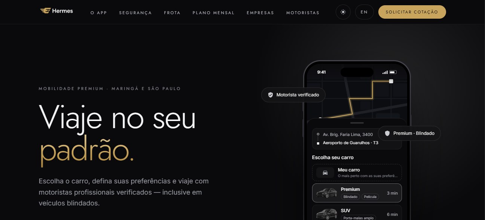
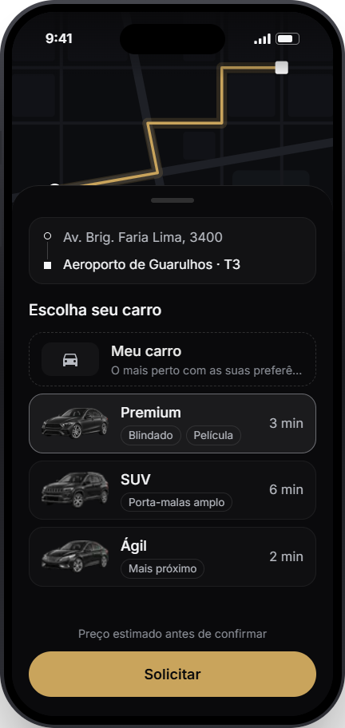
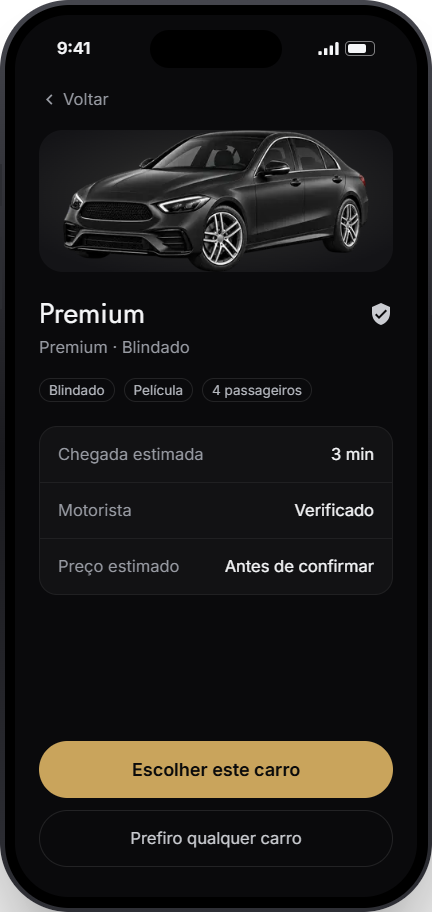
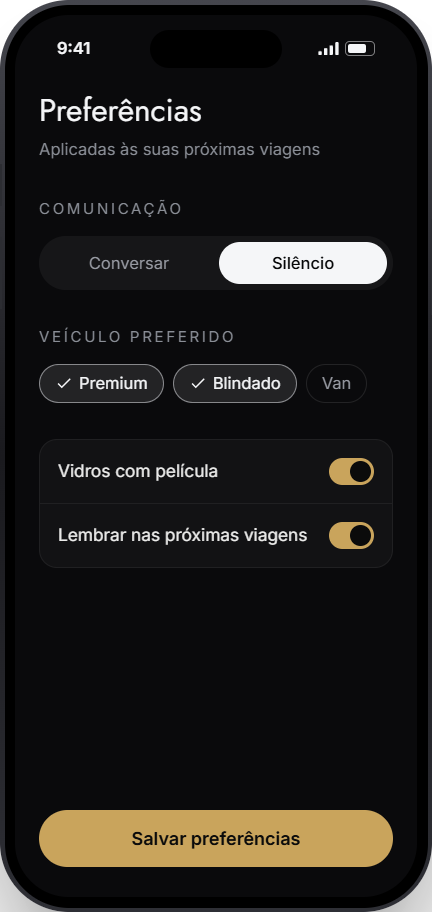
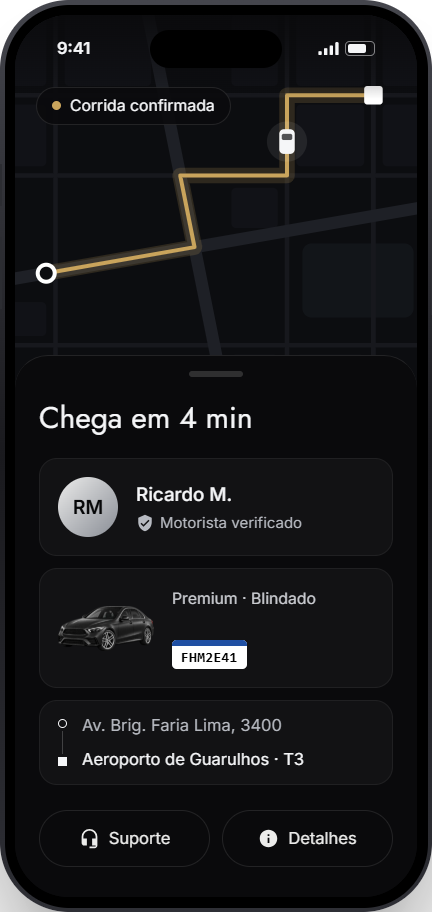

  <picture>
    <source media="(prefers-color-scheme: dark)" srcset="docs/logo-escuro.png">
    
  </picture>

<b>Mobilidade premium em Maringá e São Paulo.</b> 
App do passageiro e app do motorista, com backend próprio.

  <a href="https://hermes-site.onrender.com"><b>Site</b></a> ·
  <a href="https://github.com/ewerton20/hermes-app/releases/latest/download/hermes-passageiro.apk"><b>Baixar passageiro (APK)</b></a> ·
  <a href="https://github.com/ewerton20/hermes-app/releases/latest/download/hermes-motorista.apk"><b>Baixar motorista (APK)</b></a>

## O que é

Projeto de app de corridas com foco em previsibilidade: o passageiro escolhe o carro, e não só a categoria, vê o preço estimado antes de confirmar e acompanha a corrida ao vivo. O motorista passa por cadastro com documentos e veículo, recebe ofertas com o valor que vai receber e quanto fica com a Hermes, e acompanha ganhos, agenda e avaliações.

Contas, identidade, cadastro do motorista e corridas funcionam com um servidor real. Pagamentos ainda não estão integrados: os valores mostrados nos apps são fictícios e aparecem marcados assim.

## Instalar

| App | Para quem | Download |
|---|---|---|
| Hermes | Passageiro | [hermes-passageiro.apk](https://github.com/ewerton20/hermes-app/releases/latest/download/hermes-passageiro.apk) |
| Hermes Motorista | Motorista | [hermes-motorista.apk](https://github.com/ewerton20/hermes-app/releases/latest/download/hermes-motorista.apk) |

1. Abra o link no celular Android e baixe o APK.
2. Permita instalar apps desta fonte quando o Android pedir.
3. Abra o app e crie uma conta. O cadastro está liberado na hora: não pede selfie nem documento, e o carro do motorista já sai aprovado.

- **Sem conta:** "Explorar sem conta" abre o modo demonstração, com dados fictícios.
- **Corrida completa:** crie uma conta em cada app, de preferência em dois celulares, deixe o motorista online e peça a corrida pelo passageiro.
- **Primeira abertura:** o servidor está no plano gratuito e dorme sem uso. Ele pode levar cerca de 1 minuto para acordar, e o app espera.
- **iPhone:** ainda não há versão.

## App do passageiro

  
  
  
  

Telas da vitrine do site.

- **Pedido:** busca de endereços, rota no mapa, escolha do carro ou da categoria, filtros (blindado, número de passageiros, modo Ágil, que pede o carro com a melhor estimativa de chegada) e preço estimado válido por 5 minutos, com pedágio somado e opção de evitar pedágio.
- **Agendamento:** corrida para outro dia e horário, com a lista das agendadas.
- **Na corrida:** motorista, carro e placa; código de embarque; mensagens com o motorista; relógio da espera; aviso se o motorista se afastar, com a opção de trocar.
- **Segurança:** 190 e 192, compartilhar a corrida por um link ao vivo, gravar áudio e relatar um problema grave.
- **Assistente Hermes:** monta a rota e tira dúvidas sobre o app, por voz ou texto.
- **Depois da corrida:** resumo de para onde vai o valor (motorista, pedágio, Hermes), avaliação e "Esqueci algo no carro".
- **Conta:** lugares salvos (Casa, Trabalho), acessibilidade (cão-guia, cadeira de rodas, prefiro mensagens), português e inglês, tema escuro e claro.

## App do motorista

  <picture>
    <source media="(prefers-color-scheme: dark)" srcset="docs/motorista-escuro.png">
    
  </picture>

- **Cadastro em 7 etapas:** identidade, CNH com EAR, antecedentes, comprovante de residência, cadastro municipal (Conduapp em São Paulo, Semob em Maringá), veículo com até 5 anos e documentos do veículo. Cada item recusado volta com o motivo.
- **Ofertas:** som de chamada, 15 a 25 segundos para responder, valor que o motorista recebe, quanto fica com a Hermes, pedágio incluído e as necessidades do passageiro (malas, pet, cão-guia, cadeira de rodas, voo).
- **Na corrida:** passageiro no mapa nos últimos 500 m, código de embarque para iniciar, mensagens, navegação e segurança com gravação.
- **Ganhos:** hoje, semana e mês, com corridas, tempo online e gorjetas.
- **Gestão:** agenda, documentos com validade, veículos, vistoria a cada 90 dias e avaliações com elogios e reclamações agrupados.

## Frota

Blindado é um atributo que se combina com categorias compatíveis, como Premium ou SUV blindado.

## Tecnologia

| Parte | Stack |
|---|---|
| Apps | React Native 0.88, Expo SDK 58, Expo Router, TypeScript |
| Mapa | MapLibre com mapas do OpenFreeMap (OpenStreetMap) e rotas OSRM |
| Servidor | NestJS 12, PostgreSQL (Neon) |
| Site | Next.js 16, React 19, Tailwind 4 |
| Hospedagem | Render (API e site) |

O código-fonte é privado. Este repositório só distribui os APKs.

## Estado atual

- Projeto em desenvolvimento, sem operação comercial.
- Pagamentos, painel da equipe e versão para iPhone ainda não existem.
- Novas versões saem em [Releases](https://github.com/ewerton20/hermes-app/releases). Os links de download acima sempre apontam para a mais recente.
